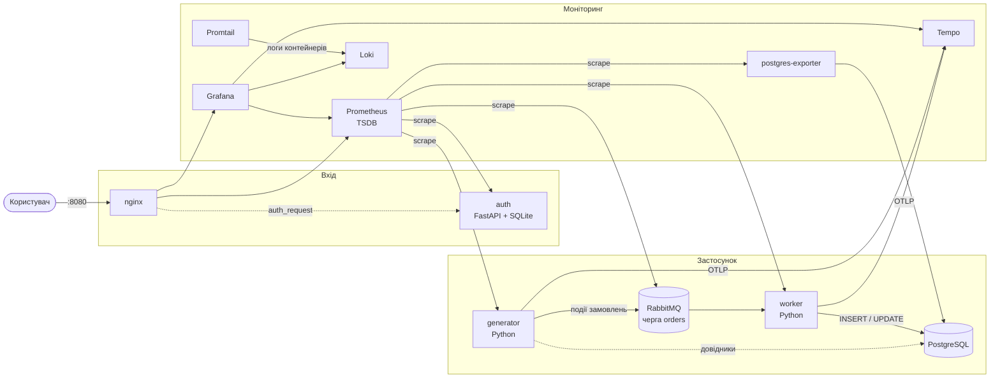
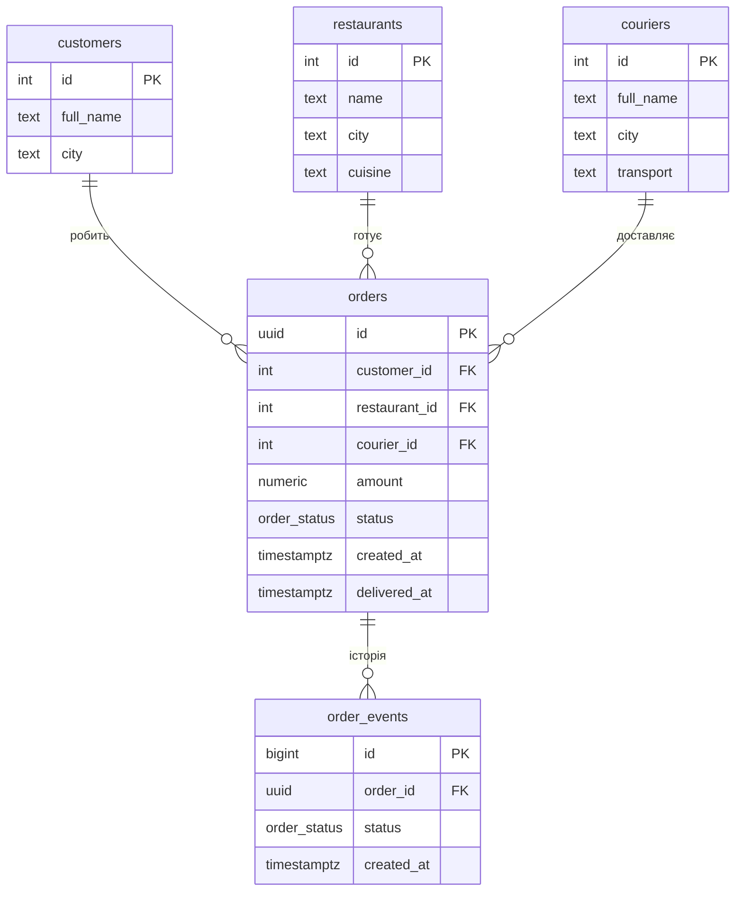
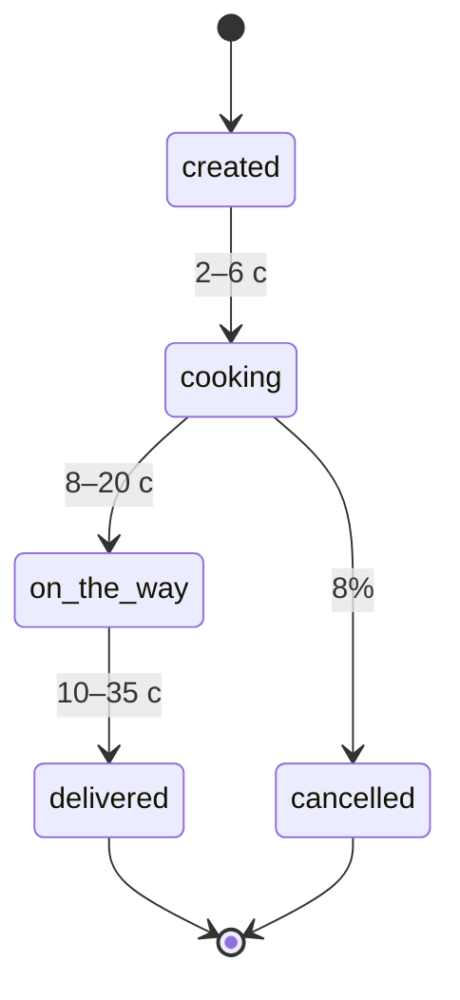
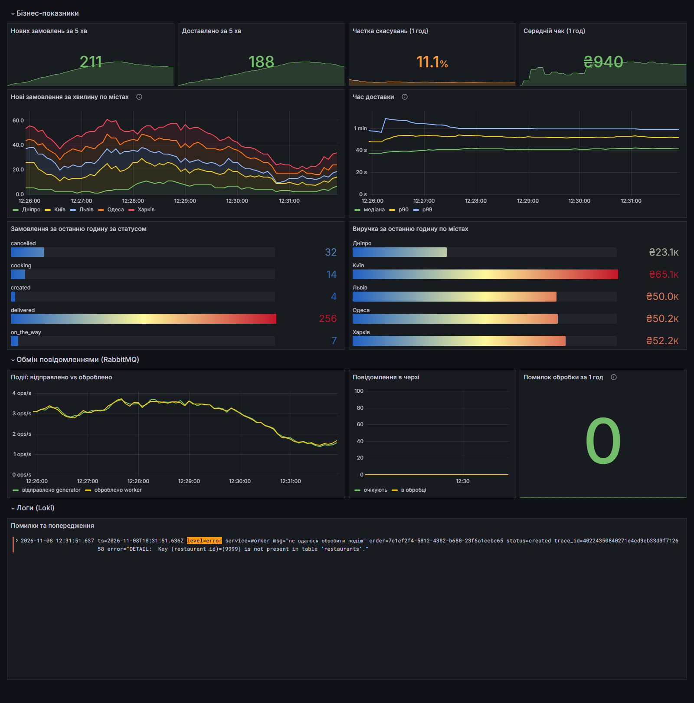
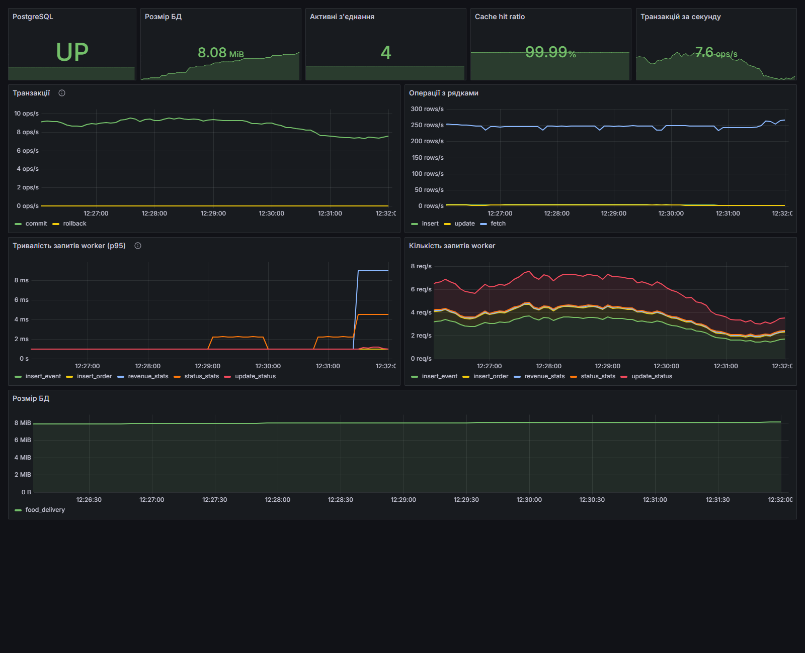
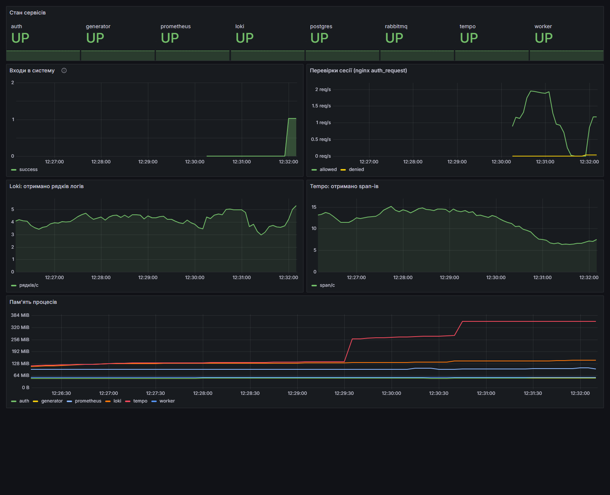
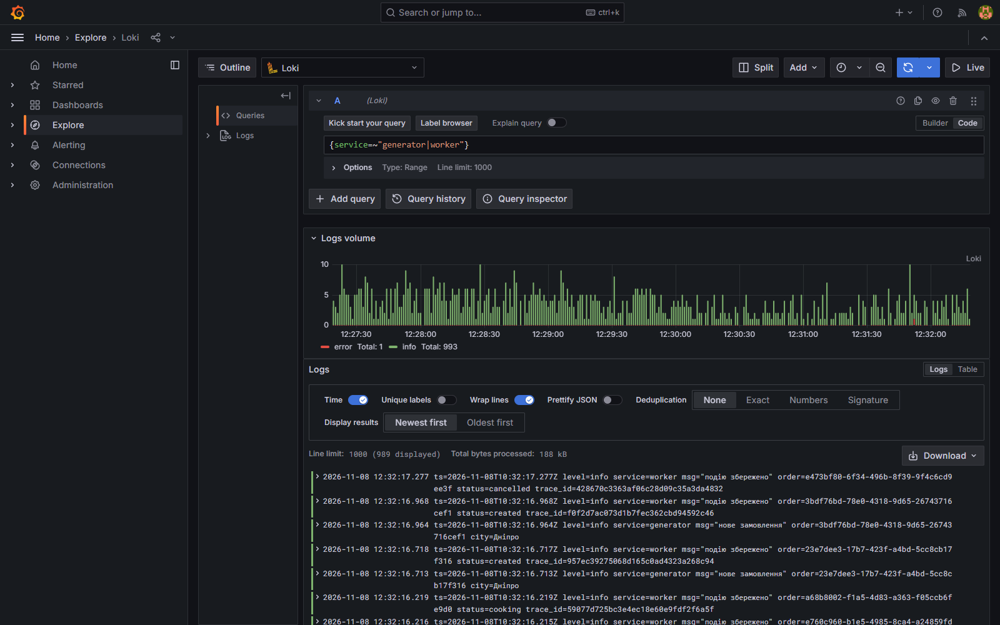
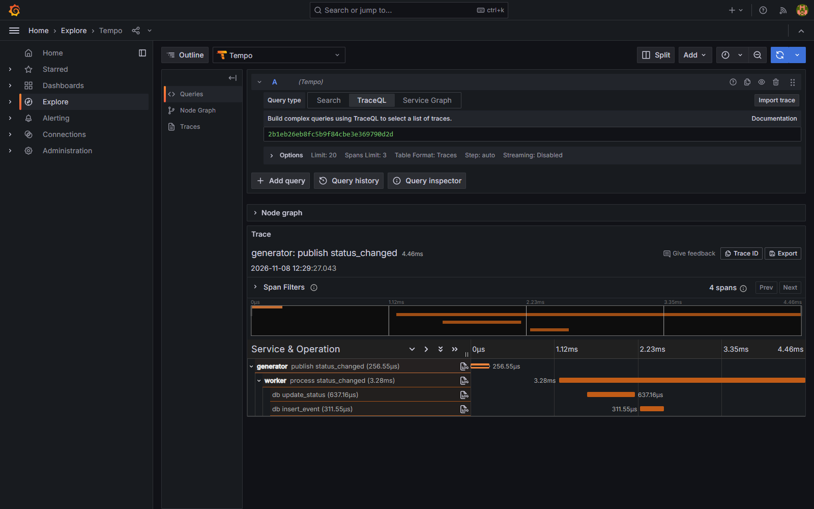
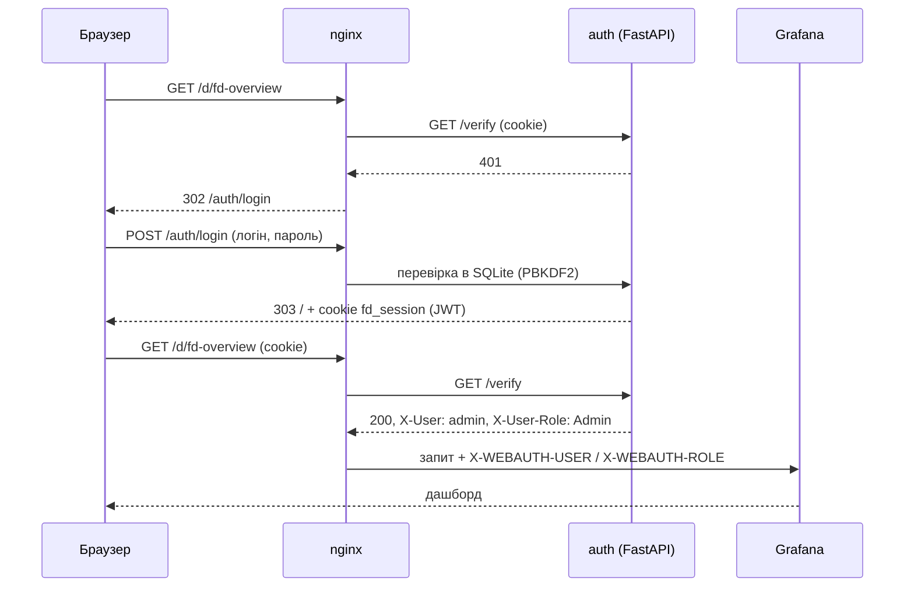
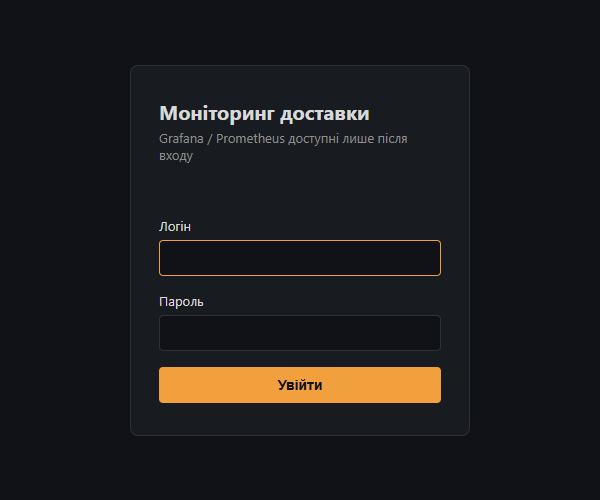

<div align="center">

Міністерство освіти і науки України<br>
Національний транспортний університет<br>
Центр заочного та дистанційного навчання<br>
Кафедра інформаційних систем і технологій

<br>

# Система моніторингу сервісу доставки їжі

**Проєкт з дисципліни: «Система моніторингу»**

<br>

Виконав:<br>
студент 1 курсу магістратури<br>
заочної форми навчання<br>
спеціальність «Комп'ютерні науки»<br>
**Шевченко Сергій**

<br>


</div>

---

## Зміст

1. [Опис проєкту](#1-опис-проєкту)
2. [Архітектура](#2-архітектура)
3. [Швидкий старт](#3-швидкий-старт)
4. [База даних і генерація даних](#4-база-даних-і-генерація-даних)
5. [Обмін повідомленнями (RabbitMQ)](#5-обмін-повідомленнями-rabbitmq)
6. [Збір метрик (Prometheus)](#6-збір-метрик-prometheus)
7. [Дашборди (Grafana)](#7-дашборди-grafana)
8. [Логи (Loki)](#8-логи-loki)
9. [Трейси (Tempo)](#9-трейси-tempo)
10. [Авторизація](#10-авторизація)
11. [Структура репозиторію](#11-структура-репозиторію)
12. [Висновки](#12-висновки)

---

## 1. Опис проєкту

Система збирає метрики про роботу з базою даних умовного сервісу доставки їжі і показує їх у Grafana. Для збору та зберігання метрик використовується Prometheus. Переглядати дані можуть лише авторизовані користувачі.

Щоб метрики були «живими», а не синтетичними числами, в проєкті є невеликий імітатор сервісу доставки. Клієнти роблять замовлення в ресторанах п'яти міст, ресторани їх готують, кур'єри доставляють, частину замовлень скасовують. Кожна така дія проходить через чергу повідомлень і потрапляє в PostgreSQL, а моніторинг показує, як із цим справляється база.

### Відповідність пунктам завдання

| № | Пункт завдання | Як реалізовано |
|---|---|---|
| 0 | СУБД у Docker-контейнері | PostgreSQL 16 (`postgres:16-alpine`), схема створюється з [`db/init.sql`](db/init.sql) |
| 1 | Генерація та актуалізація даних | Python-сервіси [`generator`](services/generator/main.py) і [`worker`](services/worker/main.py) (psycopg 3) |
| 2 | Збір даних | Prometheus + `postgres-exporter` + власні метрики сервісів (`prometheus_client`) |
| 3 | Збереження даних | Вбудована TSDB Prometheus (том `prom-data`, зберігання 7 днів) |
| 4 | Відображення даних | Grafana 11, три дашборди створюються автоматично (provisioning) |
| 5 | Логи | Grafana Loki + Promtail (збирає stdout усіх контейнерів) |
| 6 | Трейси | Grafana Tempo + OpenTelemetry SDK у Python-сервісах |
| 7 | Авторизація | Власний сервер на FastAPI + SQLite, підключений до nginx через `auth_request` |
| 8 | Контейнеризація | Docker Compose, 12 контейнерів, запуск однією командою |
| 9 | Обмін повідомленнями | RabbitMQ, черга `orders` між generator і worker |

---

## 2. Архітектура



Назовні відкритий лише порт **8080** (nginx). Grafana, Prometheus, Loki і Tempo доступні тільки всередині Docker-мережі, тому обійти сторінку входу неможливо. Додатково на `127.0.0.1` прокинуто PostgreSQL (`15432`) і панель RabbitMQ (`15672`), щоб їх можна було подивитися локально.

| Сервіс | Образ / код | Призначення |
|---|---|---|
| `postgres` | `postgres:16-alpine` | основна БД сервісу доставки |
| `rabbitmq` | `rabbitmq:3.13-management-alpine` | брокер повідомлень, плагін `rabbitmq_prometheus` |
| `generator` | `services/generator` | генерує замовлення і зміни їхніх статусів |
| `worker` | `services/worker` | читає чергу, пише в БД, рахує агрегати |
| `auth` | `services/auth` | вхід, сесії (JWT у cookie), користувачі в SQLite |
| `postgres-exporter` | `prometheuscommunity/postgres-exporter` | метрики PostgreSQL |
| `prometheus` | `prom/prometheus:v2.54.1` | збір і зберігання метрик |
| `loki` + `promtail` | `grafana/loki:3.1.1` | збір і зберігання логів |
| `tempo` | `grafana/tempo:2.6.0` | зберігання трейсів |
| `grafana` | `grafana/grafana:11.2.0` | візуалізація |
| `nginx` | `nginx:1.27-alpine` | єдина точка входу, перевірка авторизації |

---

## 3. Швидкий старт

Потрібен лише Docker Desktop (або Docker Engine з Compose v2).

```bash
git clone https://github.com/ShevSerhii/food-delivery-monitoring.git
cd food-delivery-monitoring

# необов'язково: змінити паролі
cp .env.example .env

docker compose up -d --build
```

Перший запуск займає кілька хвилин, поки завантажуються образи. Далі:

| Що | Адреса | Доступ |
|---|---|---|
| Grafana | http://localhost:8080 | `admin` / `admin123` (або `AUTH_ADMIN_PASSWORD` з `.env`) |
| Prometheus | http://localhost:8080/prometheus/ | той самий вхід |
| RabbitMQ | http://localhost:15672 | `food` / `food_pass` |
| PostgreSQL | `localhost:15432`, БД `food_delivery` | `food` / `food_pass` |

Через 2–3 хвилини після старту на графіках з'являється достатньо точок.

Зупинка:

```bash
docker compose down        # зупинити, дані залишаться
docker compose down -v     # зупинити і видалити всі дані
```

Інтенсивність навантаження можна змінити змінною `ORDERS_PER_MINUTE` у `.env` (за замовчуванням 40 замовлень за хвилину в середньому).

---

## 4. База даних і генерація даних

### Схема БД



При першому запуску [`db/init.sql`](db/init.sql) створює таблиці і заповнює довідники: 15 ресторанів у Києві, Львові, Одесі, Харкові та Дніпрі, 40 кур'єрів і 500 клієнтів.

### Життєвий цикл замовлення



Час у симуляції прискорений: секунда приблизно відповідає хвилині реального життя. Генератор:

- на старті читає з БД ресторани, клієнтів і кур'єрів (клієнт і кур'єр завжди з того ж міста, що й ресторан);
- створює замовлення з випадковою сумою від 120 до 1800 грн;
- змінює інтенсивність хвилею з періодом 10 хв, щоб на графіках були видні «години пік»;
- приблизно 1% замовлень навмисно відправляє з неіснуючим рестораном. Такі замовлення не проходять перевірку зовнішнього ключа, і на дашбордах, у логах і трейсах видно, як система реагує на помилки.

---

## 5. Обмін повідомленнями (RabbitMQ)

Generator не пише в базу напряму, а публікує події в durable-чергу `orders`:

```json
{"type": "status_changed", "order_id": "1b73014b-...", "status": "on_the_way", "courier_id": 17, "ts": 1762597044.7}
```

Worker забирає їх (`prefetch_count=20`) і в одній транзакції оновлює `orders` та додає запис в `order_events`. Повідомлення, яке не вдалося обробити, відхиляється без повернення в чергу (`basic_nack(requeue=False)`), щоб воно не оброблялося по колу.

У заголовках кожного повідомлення передається контекст трейсу (W3C `traceparent`), тому в Tempo видно весь шлях події від генератора до бази.

---

## 6. Збір метрик (Prometheus)

Prometheus опитує цілі кожні 5 секунд ([`prometheus.yml`](monitoring/prometheus/prometheus.yml)) і зберігає дані у вбудованій TSDB.

**Власні метрики застосунку:**

| Метрика | Тип | Опис |
|---|---|---|
| `fd_orders_created_total{city}` | counter | створені замовлення |
| `fd_events_published_total{event}` | counter | події, відправлені в RabbitMQ |
| `fd_events_processed_total{event,result}` | counter | оброблені worker-ом події (`ok` / `error`) |
| `fd_db_query_seconds{query}` | histogram | тривалість SQL-запитів з боку застосунку |
| `fd_delivery_time_seconds` | histogram | час від створення до доставки |
| `fd_orders_last_hour{status}` | gauge | замовлення за останню годину за статусами |
| `fd_revenue_last_hour_uah{city}` | gauge | виручка за годину по містах |
| `fd_avg_check_uah` | gauge | середній чек |
| `fd_auth_logins_total{result}` | counter | спроби входу |
| `fd_auth_verify_total{result}` | counter | перевірки сесії від nginx |

Агрегати (`*_last_hour`, `avg_check`) worker перераховує SQL-запитами кожні 15 секунд. Це заодно створює на базі «аналітичне» навантаження на читання поряд із записом.

**Сторонні експортери:** `postgres-exporter` (з'єднання, транзакції, операції з рядками, cache hit ratio, розмір БД), `rabbitmq_prometheus` (стан черг), власні метрики Loki та Tempo.

---

## 7. Дашборди (Grafana)

Джерела даних і дашборди підключаються автоматично з [`monitoring/grafana`](monitoring/grafana), вручну нічого налаштовувати не треба. Усі три дашборди лежать у папці «Доставка».

### Доставка: огляд

Бізнес-показники (замовлення, доставки, частка скасувань, середній чек), час доставки p50/p90/p99, виручка по містах, робота черги і стрічка помилок з Loki.



### Доставка: PostgreSQL

Стан БД: транзакції commit/rollback, операції з рядками, cache hit ratio, розмір бази, тривалість і кількість запитів worker-а за типами.



### Доставка: стан системи

Чи живі всі сервіси, статистика входів і перевірок сесій, потік логів у Loki і span-ів у Tempo, пам'ять процесів.



---

## 8. Логи (Loki)

Promtail через Docker API знаходить усі контейнери проєкту і відправляє їхній stdout у Loki з мітками `service` і `container`. Python-сервіси пишуть логи у форматі logfmt:

```
ts=2026-11-08T10:17:25.522Z level=error service=worker msg="не вдалося обробити подію" order=03e0d13e-... status=created trace_id=401071374b11f8e7b88022d2bf9fe3b7 error="..."
```

Для `generator` і `worker` рівень логування виноситься в окрему мітку `level`.

Приклади запитів у Grafana → Explore → Loki:

```logql
# усі помилки worker
{service="worker", level="error"}

# життя одного замовлення
{service=~"generator|worker"} |= "1b73014b-08a4-4c08-b327-29d832a43262"

# кількість замовлень за хвилину по містах (метрика з логів)
sum by (city) (count_over_time({service="generator"} |= "нове замовлення" | logfmt [1m]))

# логи авторизації
{service="auth"}
```

Біля рядка з `trace_id` Grafana показує кнопку **TraceID**, яка відкриває відповідний трейс у Tempo.



---

## 9. Трейси (Tempo)

Generator і worker використовують OpenTelemetry SDK і відправляють span-и в Tempo по OTLP/HTTP. Контекст передається через заголовки RabbitMQ, тому один трейс виглядає так:

```
generator  publish status_changed            (PRODUCER)
└─ worker  process status_changed            (CONSUMER)
   ├─ worker  db update_status               (CLIENT, db.statement = UPDATE orders ...)
   └─ worker  db insert_event                (CLIENT, db.statement = INSERT INTO order_events ...)
```

Для кожного SQL-запиту в атрибутах span-а зберігається його текст, а для невдалих подій ще й помилка PostgreSQL.

Приклади TraceQL (Explore → Tempo → TraceQL):

```
{ resource.service.name = "worker" && status = error }
{ span.order.id = "1b73014b-08a4-4c08-b327-29d832a43262" }
{ name = "db update_status" && duration > 20ms }
```

Зі span-а можна перейти до логів цього ж трейсу (налаштовано `tracesToLogsV2`).



---

## 10. Авторизація



- Користувачі зберігаються в SQLite (`/data/auth.db`, том `auth-data`). Паролі хешуються PBKDF2-SHA256 із сіллю, 200 000 ітерацій.
- Кожна спроба входу записується в таблицю `login_log` і рахується в метриці `fd_auth_logins_total`.
- Сесія живе 8 годин. Це JWT, підписаний `AUTH_SECRET`, у cookie з прапорцями `HttpOnly` і `SameSite=Lax`.
- Grafana працює в режимі [auth proxy](https://grafana.com/docs/grafana/latest/setup-grafana/configure-security/configure-authentication/auth-proxy/): довіряє заголовкам від nginx, а її власна форма входу вимкнена. Заголовки виставляє лише nginx, тому підробити їх з браузера не вийде.
- Ролі: `admin` (адміністратор Grafana) і `viewer` (лише перегляд).

Керування користувачами:

```bash
docker compose exec auth python manage.py list
docker compose exec auth python manage.py add olena --role viewer   # запитає пароль
docker compose exec auth python manage.py delete olena
```



---

## 11. Структура репозиторію

```
food-delivery-monitoring/
├── docker-compose.yml          # усі 12 сервісів
├── .env.example                # паролі та параметри
├── db/
│   └── init.sql                # схема БД і довідники
├── services/
│   ├── common/                 # спільне: логування, трейсинг, підключення
│   ├── generator/              # генератор замовлень -> RabbitMQ
│   ├── worker/                 # RabbitMQ -> PostgreSQL, агрегати
│   └── auth/                   # FastAPI + SQLite, сторінка входу, CLI
├── rabbitmq/
│   └── enabled_plugins
├── nginx/
│   └── default.conf            # auth_request, проксі на Grafana/Prometheus
├── monitoring/
│   ├── prometheus/prometheus.yml
│   ├── loki/loki.yml
│   ├── promtail/promtail.yml
│   ├── tempo/tempo.yml
│   └── grafana/
│       ├── provisioning/       # джерела даних
│       └── dashboards/         # overview, postgres, system
└── docs/screenshots/
```

---

## 12. Висновки

У результаті роботи розгорнуто систему моніторингу, яка охоплює всі три «стовпи» спостережуваності:

- **метрики**: Prometheus збирає показники PostgreSQL, RabbitMQ і застосунку, Grafana їх візуалізує;
- **логи**: Loki зберігає логи всіх контейнерів, по них можна шукати й будувати метрики;
- **трейси**: Tempo показує шлях кожної події через чергу до бази даних з текстом SQL-запитів.

Між цими трьома джерелами можна переходити безпосередньо в Grafana: від рядка логу до трейсу і назад. Доступ до системи закритий власним сервером авторизації, а все середовище піднімається однією командою `docker compose up`.

Навмисні помилкові замовлення показали практичну користь такого підходу. Одну й ту саму проблему видно одночасно на графіку rollback-ів у PostgreSQL, у лічильнику помилок worker-а, у стрічці логів і в трейсі з точним текстом помилки від бази.
